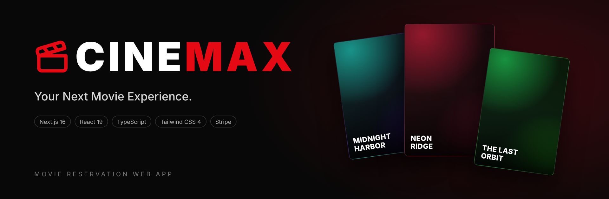
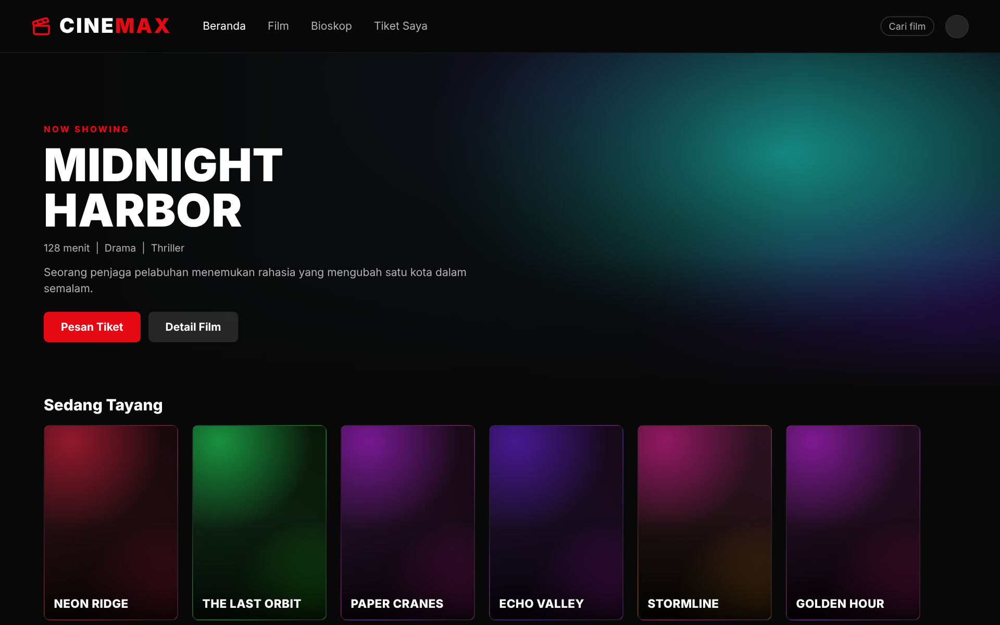
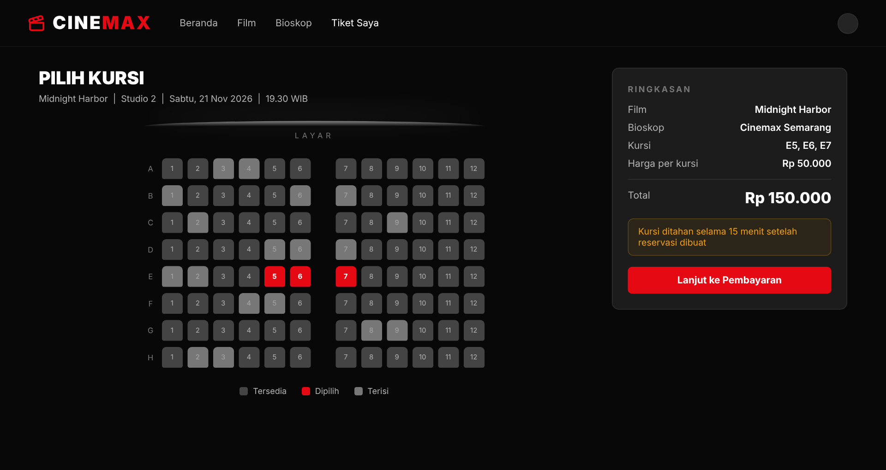
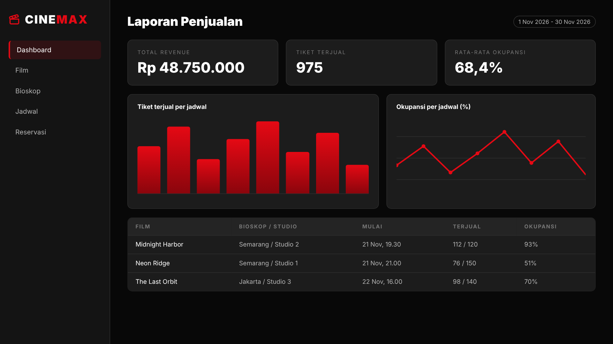
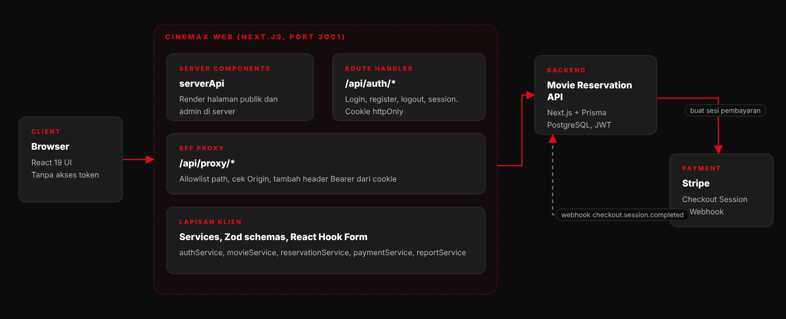

<div align="center">



**Aplikasi web pemesanan tiket bioskop dengan pemilihan kursi langsung, pembayaran Stripe, dan dashboard admin.**


</div>

---

## Tentang Proyek

CINEMAX Web adalah antarmuka frontend untuk **Movie Reservation API**. Pengguna dapat menelusuri film dan bioskop, memilih jadwal tayang, memilih kursi pada denah studio, lalu membayar melalui Stripe. Admin mendapat panel terpisah untuk mengelola film, bioskop, jadwal, serta memantau laporan penjualan.

Tampilan mengusung tema gelap bergaya sinema dengan aksen merah. Karena API film tidak menyediakan poster, setiap film mendapat poster generatif yang dibuat secara deterministik dari ID film, sehingga warna selalu konsisten tanpa memakai aset milik pihak lain.

## Pratinjau

> Gambar di bawah adalah ilustrasi antarmuka yang dirender dengan token desain proyek ini. Judul film dan angka bersifat contoh.

### Beranda



### Pemilihan Kursi



### Dashboard Admin



## Fitur Utama

**Untuk pengguna**

- Katalog film dengan pencarian, filter genre, dan pagination yang tersimpan di URL
- Detail film dengan jadwal tayang per tanggal dan bioskop
- Daftar bioskop beserta studio, kapasitas kursi, dan jadwal
- Denah kursi real-time, maksimal enam kursi per reservasi
- Checkout dengan hitung mundur masa tahan kursi (15 menit)
- Pembayaran Stripe dengan verifikasi status langsung dari backend
- Riwayat tiket, pembatalan reservasi, dan halaman profil
- Registrasi dan login dengan validasi form, opsi remember me, dan redirect `?next=`

**Untuk admin**

- Laporan revenue, tiket terjual, dan rata-rata okupansi dengan filter tanggal
- Grafik tiket terjual dan okupansi per jadwal
- Manajemen film (tambah, ubah, hapus) dengan genre berbentuk chip
- Manajemen bioskop dan studio, lengkap dengan pratinjau denah kursi
- Penjadwalan tayang dengan deteksi bentrok jadwal pada studio yang sama
- Pencarian detail reservasi berdasarkan ID

## Alur Pemesanan

1. Pengguna login, memilih film, jadwal, dan kursi yang tersedia.
2. Frontend membuat reservasi (`POST /api/reservations`) dan backend menahan kursi hingga `expiresAt`.
3. Halaman checkout membuat Stripe Checkout Session melalui `POST /api/payments/checkout`.
4. Pengguna membayar di Stripe lalu kembali ke `/payment/success`.
5. Halaman tersebut melakukan polling reservasi. Pembayaran dianggap berhasil hanya jika status reservasi `CONFIRMED` dan pembayaran `PAID`, yang diset backend setelah menerima webhook Stripe.

Redirect dari Stripe sendiri tidak pernah dianggap sebagai bukti pembayaran.

## Arsitektur



Browser tidak pernah memanggil backend secara langsung. Seluruh request melewati Next.js yang berperan sebagai Backend for Frontend (BFF):

- `/api/proxy/*` meneruskan request ke backend dengan allowlist path, pemeriksaan Origin, dan header `Authorization: Bearer` yang diambil dari cookie.
- `/api/auth/*` mengelola sesi (login, register, logout, session).
- Server Components memanggil backend langsung lewat `serverApi`.
- JWT disimpan di cookie `httpOnly`, `SameSite=Lax`, dan `Secure` pada production. Token tidak masuk ke `localStorage` maupun response body.
- Halaman `/admin/*` dijaga di sisi server berdasarkan role `ADMIN`, sementara backend tetap menjadi otoritas akhir.

## Teknologi

| Kategori | Pustaka |
|---|---|
| Framework | Next.js 16 (App Router), React 19 |
| Bahasa | TypeScript |
| Styling | Tailwind CSS 4 |
| Form dan validasi | React Hook Form, Zod |
| Visualisasi | Recharts |
| Animasi dan UI | Framer Motion, Lucide React, Sonner |

## Struktur Proyek

```text
src/
├── app/
│   ├── (site)/          Halaman publik dan pengguna
│   ├── admin/           Panel administrasi
│   └── api/             Route handler: auth dan proxy
├── components/          UI, film, booking, auth, layout, admin
├── services/            Klien API per domain (movie, reservation, payment, ...)
├── lib/                 Config, session, JWT, schema Zod, utilitas
├── providers/           Auth dan provider global
├── hooks/               Custom hooks
└── types/               Tipe kontrak API
docs/
├── BACKEND_ANALYSIS.md  Kontrak dan batasan backend
└── MANUAL_TESTING.md    Checklist uji manual
```
